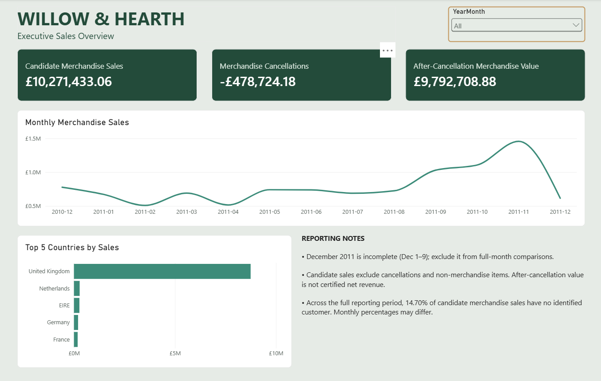
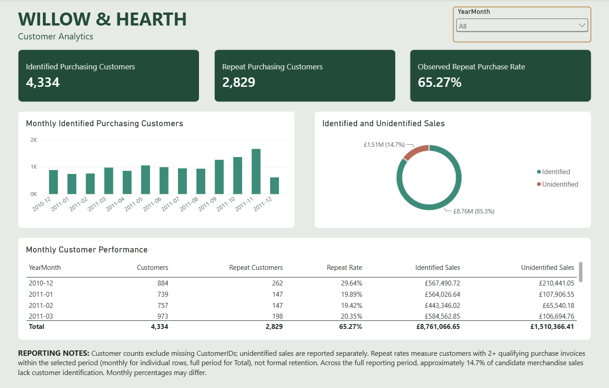
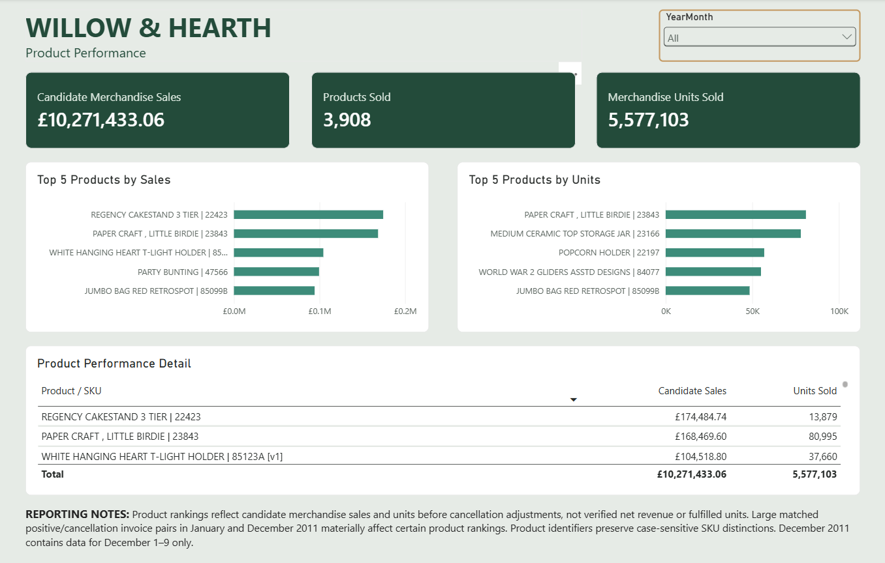

# Willow & Hearth Retail | E-commerce Sales & Customer Intelligence

**Self-directed simulated retail analytics case study** | Python | Power BI | Data quality | Customer and product analysis

How can an online retailer tell whether sales growth is healthy, which customers and products drive performance, and whether unusual transactions distort the picture?

This project uses **541,909 historical transaction records** to produce a **four-page Power BI dashboard**, management findings, and documented data-quality investigations. It illustrates the value of interpreting sales, purchasing patterns, customer coverage, and product rankings before making decisions.

**[View the five-page portfolio case study (PDF)](assets/P001_Portfolio_Case_Study_FINAL.pdf)** · **[Read the full case study](PORTFOLIO_CASE_STUDY.md)**

> **Disclosure:** Willow & Hearth Retail and Sarah Mitchell are fictional. This is a self-directed simulation using public historical data, **not** a paid client engagement or evidence of implemented commercial results. The simulated handoff was internally approved on November 17, 2026, with eight unresolved exceptions and documented analytical limitations.

## Dashboard previews

### Executive Sales Overview

Historical candidate merchandise sales, cancellations, monthly trends, and geographic performance. The financial values are not accounting-certified revenue or profit.



### Customer Analytics

Identified purchasing customers, observed repeat purchasing, and the value of sales without verified customer identifiers. Repeat purchasing is not formal customer retention.



### Product Performance

Product rankings by candidate sales value and merchandise units, with reporting limitations documented alongside the visuals.



The complete four-page Power BI report also includes a Sales Performance page, which is not reproduced in this preview set. See the [portfolio case study PDF](assets/P001_Portfolio_Case_Study_FINAL.pdf) for additional presentation and findings.

## The business questions

- **Sales performance:** Did candidate merchandise sales change because of order count, average order value, or both?
- **Customer visibility:** How much sales value cannot be linked to an identified customer, and what can we actually measure about repeat purchasing?
- **Product performance:** Which products lead by sales value versus units, and are rankings sensitive to unusual transactions?
- **Customer and market concentration:** Do country-level totals reflect broad demand or a few major accounts?
- **Data reliability:** Which exceptions should be resolved before the owner acts on a KPI?

## Verified results at a glance

| Measure | Result | What it means |
| --- | ---: | --- |
| Source transaction records | **541,909** | Original records preserved |
| Candidate merchandise sales | **£10,271,433.06** | Positive qualifying transaction value; **not certified revenue** |
| Merchandise cancellations | **−£478,724.18** | Signed qualifying negative entries; **not verified physical returns** |
| After-cancellation merchandise value | **£9,792,708.88** | Provisional balance; **not net profit or certified net revenue** |
| Qualifying merchandise orders | **19,773** | Distinct qualifying invoices |
| Identified repeat purchasers | **2,829 / 4,334 (65.27%)** | Two or more qualifying invoices in the observed window; **not formal retention** |
| Sold SKUs | **3,908** | Distinct qualifying case-sensitive product identities |

### Five business-relevant findings

**1. Sales growth did not translate into higher average order value.** October-to-November candidate merchandise sales rose **31.72%**, qualifying orders rose **37.21%**, and average order value fell **4.00%**. This motivates investigating order mix, not assuming a cause.

**2. Missing customer identifiers materially limit customer reporting.** Across the full extract, **£1,510,366.41 (14.70%)** of candidate sales could not be attributed to an identified customer. Unidentified transactions accounted for **21.65% of November candidate sales** and **61.12% of the October-to-November increase**. Those last two figures use different denominators.

**3. Two matching invoice pairs can distort product rankings.** Equal positive and negative legs total **£245,653.20** on each side. A separate **four-row sensitivity**, not the official report, changes candidate sales from **£10,271,433.06** to **£10,025,779.86** and cancellations from **−£478,724.18** to **−£233,070.98**. Provisional after-cancellation value remains **£9,792,708.88**. The pairs' business purpose remains unconfirmed.

**4. Sales value and unit volume tell different product stories.** The top five products by candidate sales represent **6.24%** of candidate sales. Rankings by units differ. Neither is evidence of profit or an inventory replenishment requirement.

**5. Geographic sales can be concentrated in a few accounts.** The United Kingdom accounts for **85.16%** of candidate sales, while the largest identified account represents **98.33%** of Netherlands and **90.15%** of Australian candidate sales. Country totals do not demonstrate broad international demand.

**Potential management follow-up:** Investigate customer-ID capture, obtain source-system evidence for the large matching invoices, review order composition, examine account concentration, and collect actual costs and inventory data before pricing or stock decisions. These are proposed next investigations, not actions implemented by a real client.

## Four-page Power BI dashboard

| Page | Business focus |
| --- | --- |
| **Executive Overview** | Candidate merchandise sales, signed cancellations, provisional after-cancellation value and orders |
| **Sales Performance** | Complete observed months, trends, order volume and average order value |
| **Customer Analytics** | Observed repeat purchasing, identification coverage and geographic concentration |
| **Product Performance** | Sales-value and unit rankings, anomalous transaction sensitivity |

The public repository includes the [five-page illustrated case-study PDF](assets/P001_Portfolio_Case_Study_FINAL.pdf), but **does not currently include separate dashboard screenshots**. The underlying PBIX, transaction data, and internal simulated-client handoff documents are not published.

## Methodology and technical evidence

1. **Preserve and profile the source.** Retain original records and traceable identities; flag potential duplicates without treating matches as proven errors.
2. **Define eligible transactions.** Separate candidate merchandise sales, signed cancellations and non-merchandise entries using explicit classification rules.
3. **Reconcile each metric.** Validate totals, orders, identified purchasers, products, units, dates and the exact four-row sensitivity.
4. **Model and report.** Use fact and dimension tables, DAX and four management-facing Power BI pages. Preserve exact case-sensitive product identity to avoid collisions between raw SKU codes.
5. **Disclose uncertainty.** Keep eight unresolved exceptions visible and distinguish independently executed QA from owner-reported manual acceptance.

**Technical references:** [Full case study](PORTFOLIO_CASE_STUDY.md) · [Methodology](METHODOLOGY.md) · [Reporting definitions](REPORTING_DEFINITIONS.md) · [Quality assurance](QUALITY_ASSURANCE_SUMMARY.md) · [Eight unresolved exceptions and limitations](LIMITATIONS.md).

### Reproduce the available processed-fact checks

The included read-only Python verifier requires Python 3.10+ and a matching processed-fact CSV supplied locally:

```sh
python scripts/verify_fact_kpis.py --fact /path/to/P001_fact_transactions.csv
```

The verifier checks approved **processed-fact KPIs** and fails on mandatory mismatches. It does **not** reconstruct the complete project from the original workbook or independently certify a running Power BI model. Earlier independent Python reconciliation and saved-visual static checks are documented; live dashboard testing is owner-reported, and complete current-version model equivalence remains unverified. See [QA scope](QUALITY_ASSURANCE_SUMMARY.md).

## Source, limitations and attribution

**Source:** Chen, D. (2015), *Online Retail*, UCI Machine Learning Repository. [Dataset](https://archive.ics.uci.edu/dataset/352/online%2Bretail) · [DOI: 10.24432/C5BW33](https://doi.org/10.24432/C5BW33) · [CC BY 4.0](https://creativecommons.org/licenses/by/4.0/).

The extract spans **December 1, 2010 to December 9, 2011**. December 2011 and the last recorded day are incomplete. Candidate merchandise sales are not certified accounting revenue; cancellation entries are not proven returns; after-cancellation value is provisional. Missing customer IDs constrain identified-customer analysis, and observed repeat purchasing is not formal retention or lifetime value. **Profit, margins, marketing ROI, inventory availability, and recurring seasonality cannot be established.** Eight exceptions remain open; see [LIMITATIONS.md](LIMITATIONS.md).

[Data source documentation](DATA_SOURCE.md) · [License and attribution notes](LICENSE_OR_ATTRIBUTION.md). A license for original code and writing remains the project owner's decision; the source dataset's license does not automatically license that original material.
